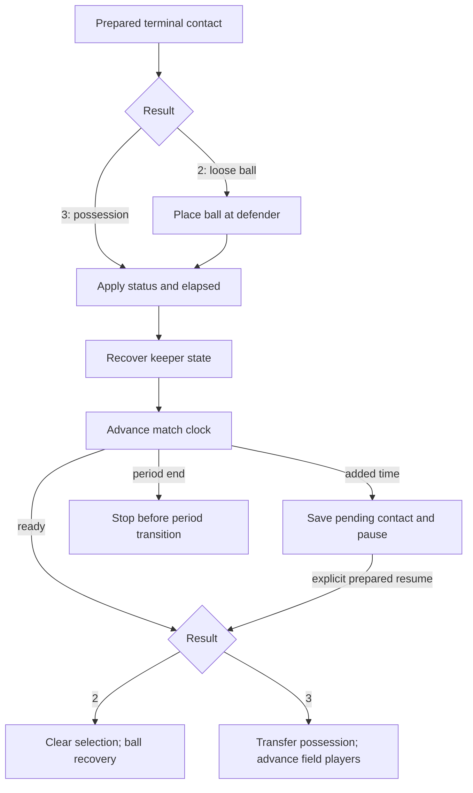

# Native contact clock and phase sessions

The native session now joins terminal flight results2/3 to contact status, elapsed time, keeper recovery, clock events and the existing possession/recovery tails. This is a development phase checkpoint, not a playable match or a complete save format.

## Supported sequence



Input is after rewards and earlier presentation, before original `$9095`. Rewards are not inferred. Supported terminal contacts use an opposing field player, action0/2 and subtype0/128. The broader pure contact prelude also accepts the seven elapsed/status rows and keeper role distinction.

The original places the loose ball before calling the clock, but transfers possession after the clock returns. An interrupted possession result therefore retains the old owner and side. A pending added-time contact can resume only through an explicit call; period end has no invented continuation.

## Clock details

- Elapsed is added to the field phase byte, then keeper/shared recovery runs before clock branching.
- A nonzero main clock subtracts elapsed with the original word/sign behavior. Zero elapsed returns without a display request.
- The one-time warning checks the resulting low byte against30, even when the high byte is nonzero. Display and warning requests are returned as events; native rendering/audio remain separate.
- Main-clock exhaustion can add12 to the extra-time byte from random bit7. A nonzero result clears ball mode and script bit6, then pauses before the original added-time presentation.
- Already-zero main time subtracts from the extra-time byte. A negative-byte result branches to period end **before storing** that candidate.
- Crossing the main clock to zero with zero extra time returns normally; period end can occur on a subsequent clock call.

## Development commands

Build with `make -j2 all`, or CMake with `BUILD_TESTING=OFF` for production targets. No automated tests were added or run for this increment.

```sh
python3 tools/export_shot_content.py /private/original.nes /private/content.cmjpack
python3 tools/export_phase_session.py /private/contact-entry-ram.bin /private/entry.cmjsession
build/captain-phase-session /private/content.cmjpack /private/entry.cmjsession \
  --contact 3 --defender 1 --capture /private/next.cmjsession --interactive
```

Interactive commands: `state`, `contact CODE DEFENDER ACTION SUBTYPE`, `resume`, `advance N`, `save NEW.cmjsession`, `quit`. Movement commands consume explicit elapsed without advancing the clock again. Commands calculate copied state before committing it; snapshot creation refuses existing files. This laboratory does not establish that an arbitrary contact is a legal match action.

`resume` deliberately accepts otherwise frozen development state after a presentation boundary. It does not reproduce original NMI/controller/random updates during the wait. A real presentation layer must supply the appropriate post-wait state before resuming.

## Private formats

`CMJSHOT5` adds35 private bytes to version4: field elapsed14, keeper elapsed14, defender status7. Canonical export size is18,615 bytes. Readers retain versions1–4; session operations require version5 movement/contact content.

`CMJSESSION1` is exactly264 bytes, explicitly encoded:

| Section | Bytes |
| --- | ---: |
| Magic | 11 |
| Complete `CMJFIELD1` section | 239 |
| Remaining word, extra byte, warning flags, script flags, ball mode | 6 |
| Shared recovery flags/timer | 2 |
| Phase and pending flag | 2 |
| Pending code/defender/action/subtype, or zero padding | 4 |

Readers reject bad versions, truncation, trailing data, invalid phase/contact relationships and nonzero unused pending padding. Phases are field0, player control1, ball recovery2, added time3, period end4. This still omits experience, score, match scripts, presentation tasks and other full-match state. It is not a network protocol or a supported user save format. ROMs, exported packs, RAM and session snapshots remain private and ignored by Git.

## Evidence and limits

Observed nine original clock executions, including low-byte warning behavior, zero-delta handling, underflow, added-time and period-end branches. Original execution used the existing disclosed cooperative-task setup: host frame/input/display acknowledgements and one graphics descriptor per frame; no NMI, audio, PPU execution or real timing. The display call initially stalled without those acknowledgements; no original calls were skipped to obtain final observations.

Normal native clock commands produced the same represented numeric fields/events for those inputs. Two coherent contact-entry observations then continued through the original terminal handlers. Their264-byte final session exports matched normal native output byte for byte:

| Observation | Resulting phase | Shared SHA-256 |
| --- | --- | --- |
| Level1 terminal result3 | Player control, clock452 | `9999bff5b00c11d761e9582e4a5f158ec18f143d1ffd5cbb5c1d4847f41e6611` |
| Level5 terminal result2 | Ball recovery, clock452 | `25b0e52442da4b348215ec42e79ed1ccf1dc3ae1fb03ad798386ae2da2fc2ad9` |
| Main time1, random128 | Added-time pause, extra12, old owner retained | `f72ab4e543381a360b7ce6a3108bc2f8a3dfe74dd547adf59d967f1301bae16c` |
| Main/extra time0 | Period-end pause, old owner retained | `49797c76b86671b4b66c8033e596ec8db7bb8c1b327dcd8fd1b410a1464417d3` |

These are bounded observations and production usage, not a passing automated suite or full original-game equivalence. Live frame scheduling, rewards, the period transition and autonomous ball-recovery/control progression remain future integration work.
