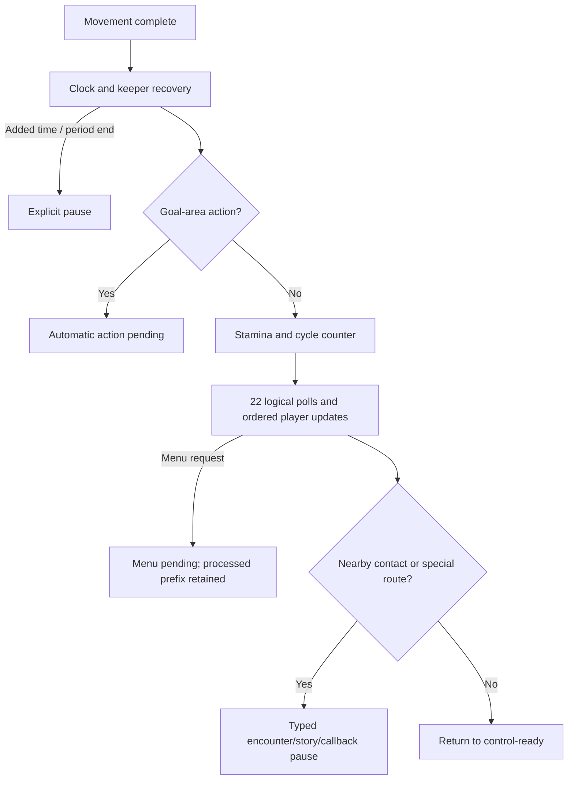

# Ordinary native control cycles

The persistent session now joins logical movement to clock/keeper recovery, stamina changes and a field-player round, then returns to control-ready when no encounter or special route interrupts it. Repeated logical walking works in the development laboratory. Live rendering/controller/NMI timing, encounter menus and a complete match remain unfinished.

## Clock and energy

`advance-control` begins at the original post-input `$E1E7` boundary. It resets the elapsed byte, adds1 and recovers keeper/shared state before numeric clock branching. Period end stops immediately. Added time pauses in a dedicated phase and resumes only through `resume-control-time`, without repeating clock/recovery.

Prepared added-time resume follows the known presentation-state reset when script bit7 remains set: script/ball flags128, travel0, display parameter2 and the represented0469 high byte1. The full refresh also clears the raw cosmetic motion flag; a watched original trace located that reset in display/background callbacks. Setup now models the same known refresh reset. This is a post-refresh state rule, not an audio/render-driven gameplay clock.

After a ready clock, the goal-area gate checks the **defending keeper's recovered stun**, forward ball X at least196 and Y116–139. It pauses before automatic goal-area action and clears script/ball flags. An early assumption that the carrier status controlled this gate was corrected by direct `$CD77` byte inspection and keeper-stun observations.

Otherwise increment the field-cycle byte and apply original energy rules:

- Maximum stamina uses wrapped base+level, clamped95, into a96-word curve; it differs from the standard doubled-level skill rule.
- Human-side players0–10 other than the carrier regenerate2, capped at their loaded maximum. Addition wraps16bits before the cap.
- Type32 regenerates1 and stays at0 when already0.
- Energy-counter255 wraps and skips regeneration for that call; carrier drain still runs.
- A human carrier loses3, or5 for type32, clamped at0. Opposing carriers are not charged by this caller.

The resulting phase waits for the field round. No counter/energy changes are applied before period/added-time or goal-area diversions.

## Field round

`advance-world` supplies one explicit held/pressed pair for each of the22original E349 polling points, including keeper and skipped-player slots. The C++ API accepts22independent samples. The decision timer is not decremented by these inner polls.

For each slot, apply buttons first, then skip keepers, the human carrier, or the currently controlled human defender during opposing possession. Changing defenders during the round therefore changes which player is skipped. A menu request commits the already-processed prefix and stops the round, reporting the number of consumed samples.

Coarse ball-region changes enable target selection/RNG shifting for non-carriers. Speeds use selectors33/34 for ordinary team movement,31 for off-possession target240 chasing, and32 for the carrier. Nonzero status decrements once and skips movement; other players take the existing elapsed1 direction/coordinate step. The phase-local ball remains where the earlier control step placed it, even when an AI carrier moves during the round.

At the end, clear selection. Every fifth field cycle, select nearby opposing field players using the existing strict radius7/cap/status rule. A nonempty result pauses for contact with retained IDs and cleared script/ball flags. Otherwise stop at the existing story gate or special callback when required, or return to control-ready.



## Usage and persistence

```sh
build/captain-phase-session /private/content-v8.cmjpack /private/after-input.cmjsession \
  --advance-control --capture /private/before-field.cmjsession
build/captain-phase-session /private/content-v8.cmjpack /private/before-field.cmjsession \
  --advance-world 1 0 --capture /private/after-field.cmjsession
```

Interactive commands have the same names. `advance-world HELD PRESSED` broadcasts a sample to22slots. `advance-world-file FILE` reads exactly22held/pressed byte pairs, allowing distinct input at every poll. Its corresponding option is `--advance-world-file FILE`. Missing/out-of-range/trailing input is rejected before simulation mutation. Other calculation errors also leave the retained session unchanged.

Current content8 appends256selector31 speed words and96maximum-stamina curve words (704private bytes), totaling20,020bytes for the canonical export. Readers retain content1–7.

Session6 is314bytes: session5 plus presence and an8-byte scheduling payload:

| Field | Bytes | Source |
| --- | ---: | --- |
| Field cycle | 1 | `$0613` |
| Energy cycle | 1 | `$0618` |
| Special callback flags | 1 | `$044B` |
| Selected field-player prefix | 5 | `$0601..$0605`, count in existing field state |

Unused selected slots are canonical zeros, not copied stale RAM. IDs/counts are bounded, and a field-contact continuation requires opposing players and the side-specific cap. New phases are field round13, control added time14, field contact15, goal-area action16 and special callback17. Existing story phase8 remains. These phases require captured scheduling and existing controller/recovery/experience context; field-round/added-time states require elapsed1. Versions1–5 remain readable with missing scheduling explicit; they cannot silently continue a control tick. `--without-scheduling` omits that context from export when the phase allows it. All original RAM/packs/snapshots remain private.

## Original observations and native usage

The bounded observer now supports clock, prepared added-time resume and22-sample field-round modes. It retains explicit host frame/display/input/graphics acknowledgements, with no skipped original calls, NMI, audio/PPU execution or real timing. A synthetic caller return for field/resume entry is disclosed by the tool setup; these are staged observations rather than full hardware execution.

Twenty-six private boundary observations cover clock warnings, period end, both added-time resume branches, wrapped energy/counter rules, type32, both possession sides, defending-keeper stun recovery, goal-area gates, stable/changing regions and chase speeds, dynamic defender cycling, a late menu interruption after six polls, nearby contact, special callbacks and story gates. Current native represented314-byte outputs agree in manual hash inspection. The initial added-time difference was the cosmetic motion flag described above and is retained privately alongside corrected output.

| Representative state | Shared SHA-256 |
| --- | --- |
| Ordinary clock/energy complete | `7b54b4f60df0ba8e02d27b5ce24440e734a1ba415041035fb220633ae3fda327` |
| Ordinary field round complete | `726c0a02f3679be1caa50dffd5588e9625b2dfe6d20358e9f4a4ba3faa1f0abe` |
| Prepared added-time resume | `c5f7bda1e854c02085fbfc5c65aaefa3269681ec3ee0e3d373f9af2fbbe18065` |
| Late menu interruption | `a674c6142198ad27ead58b6ffc98e3eab60170b7ce0a86969497e93cf8a2c84b` |
| Nearby contact | `b974c55205f6ce54ffdc9bac69ff0bb4ba56e7e830986e31a3e6f2e8346ca085` |

Normal retained-session usage completed five walking cycles. Saved native/original state agrees at each boundary: carrier X91→95→98→102→106→109, clock452→447, then opposing player16 is selected for contact. The fifth-cycle shared hash is `366c582a59a7490d09790da1121a684c91748b8d5c7ecd68876acaec7991dbe8`. A further poll is rejected while the encounter is pending.

Production Make/CMake builds and one fresh static review are recorded in the work log. No automated tests were added/run. This is progress toward coherent simulation; it does not establish live frame fidelity, actual action/AI menus, rendered gameplay, online match readiness or a complete playable match.
