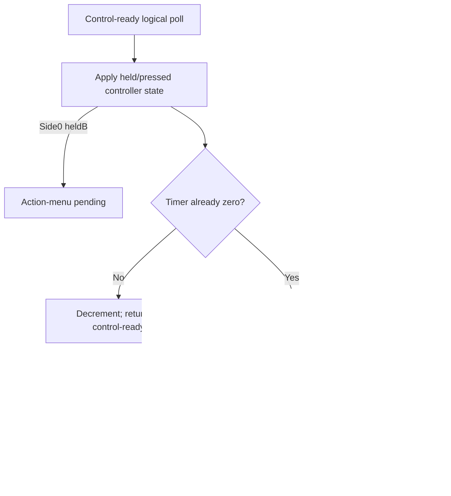

# Logical control polls and controlled movement

The persistent native session now accepts explicit held/pressed button masks after control setup. It updates controller state on each logical poll, moves the controlled player at the original decision boundary, and pauses before the next clock, menu or AI stage. This is backend input/movement support, not a live playable window or a complete match tick.

## Input and timing

| Button | Mask |
| --- | ---: |
| Right / Left / Down / Up | 1 / 2 / 4 / 8 |
| Select / Start | 16 / 32 |
| B / A | 64 / 128 |

Held and pressed are separate staged bytes. The caller supplies logical inputs; the engine does not invent a controller sampling frequency or derive edge history in this operation.

Side0 possession:

- HeldB takes priority and requests the action menu. Selected-defender count and script flags are cleared; the timer and ball mode are retained at this boundary.
- Otherwise, any direction requests motion and clears script bit6. Facing is0 when Left is present,64 otherwise. With no direction, script bit6 is set and facing is retained. A alone does not open this menu.

Side11 possession:

- Motion is requested on every poll.
- PressedA cycles the controlled side0 defender forward; otherwise pressedB cycles backward. IDs wrap1↔10, and A wins when both are pressed. Cycling does not skip unavailable players.
- A changed selection emits the existing side0-defender status display requests.

For an ordinary poll, a nonzero timer decrements and returns to control-ready. A timer already0 resets to10 and runs the movement/ball-refresh step. Starting at10 therefore takes ten decrementing polls and an eleventh poll to step. This is the original logical counter behavior, not an assertion about real frame duration.

## Movement

Side0 moves its carrier with raw selector32 speed. Side11 moves the selected human defender with selector34. The held-direction sample at the decision boundary is used; earlier held directions are not accumulated.

Both axes use the existing wrapped16-bit/clamped-high-byte movement helper. Fractions are preserved, diagonal movement uses full speed on both axes, and a pair of opposite axis bits selects the positive direction. Facing still follows the Left bit, so opposite horizontal inputs can move right while retaining left-facing state, as observed in the original. No new status gate is inserted into controlled movement.

Afterward, ball coordinates/cell refresh from the carrier. If an opposing carrier's cell differs from its saved cell, update that saved cell and pause before its AI decision. Otherwise pause before the original clock step. The operation does not advance match time, recover stamina, update other players or run a menu/AI handler.



## Development usage

```sh
build/captain-phase-session /private/content-v7.cmjpack /private/control-ready.cmjsession \
  --poll-control 1 0 --capture /private/after-poll.cmjsession
```

Interactive command: `poll-control HELD PRESSED`. `state` shows timer, facing, selection, motion request and the resulting phase. A poll at a clock/menu/AI pause is rejected; no following stages are silently acknowledged. Commands calculate copied state and commit only on success.

## Private formats and phases

`CMJSHOT7` appends512private bytes to content6:256little-endian selector32 speed words. Canonical export size is19,316bytes. Readers retain versions1–6, while polling requires the new content so carrier speed cannot silently use a team-movement table.

`CMJSESSION5` is305bytes: the version4 layout with its marker changed and an added motion-request byte `$0532` at the end of the existing optional control payload. Absent control context requires eight zero payload bytes. Versions1–4 remain readable. Version4's missing motion byte defaults0; every supported poll overwrites it before reading any result dependent on it. Earlier snapshots without control context still cannot poll.

New phases are clock pending10, action-menu pending11, AI cell decision12. Like control-ready9, these require captured experience/recovery/control context, zero selected count, an interior ball and a field owner on the possession side; side11 also requires controlled defender1–10. Codec bounds, unused-padding and truncation/trailing checks remain strict. Original content, RAM and generated snapshots stay private.

## Evidence and scope

The bounded original observer now accepts exclusive `--poll-control HELD PRESSED`, entering at `$E14A` after the original yield. It stops at `$E145` for another poll, `$E1E7` before the clock step, `$E38A` before the menu script request, or `$E19B` before the AI cell handler. Host acknowledgements retain the explicit held/pressed masks. No original calls are skipped; NMI/audio/PPU/hardware timing are not emulated.

Sixteen private original observations cover idle/directional waiting, timer1→0, directional/diagonal/opposite inputs, fractional edge clamping, heldB priority, defender cycling and both wraps, A+B priority, movement immediately after cycling an unavailable defender, opposing idle stepping and AI cell diversion. Normal native outputs agree with all sixteen represented305-byte original exports in manual hash inspection.

| Representative observation | Shared SHA-256 |
| --- | --- |
| Carrier right, timer0 | `b6ae34b375efaa4b6f8b4fddda6326596e5eca3e78a4a94160e0d4d645ec1f27` |
| Opposite directions | `3c3b05b093f1d3f8eb67c6f46d29240638913437bd3532e0d8ced048669183c3` |
| Action-menu priority | `770190991e5be579f09b9b47ea009244d59d80b59cb2a41776c950f8a652dcd7` |
| Move defender after cycling | `7e143bd8f8dc4a8098a58aa1495d48bda2b83f7767f2ca76dbeabfde8891239c` |
| Opposing carrier cell change | `eb4b88291a1dbf1395d1806066898d35a2ce4c275fbcf5793ceff117b00aeac9` |

Normal interactive usage loaded a version4 setup snapshot, decremented10→0 across ten polls and moved the carrier on the eleventh using speed928. Its resulting saved-state hash agrees with the original timer0 rightward step. A twelfth poll was rejected at the clock boundary without mutation. Existing display-request IDs agree with the inspected original defender-cycle reports.

Production Make/CMake builds and one fresh whole-plan static review are recorded in the work log. No automated tests were added or run. Full clock/AI/menu continuations, stamina/other-player advancement, action selection, real controller integration and live frame/random scheduling remain unfinished.

The fresh review found no material findings and corroborated the original button/timer/movement/stop-point bytes and existing evidence. It did not execute the implementation or reproduce the complete observation set.

The later [ordinary control cycle](NATIVE_CONTROL_CYCLE.md) connects phase10 through clock/energy and field advancement, introducing content8/session6 while retaining this polling operation and old readers. The305-byte observations above describe the polling checkpoint.
