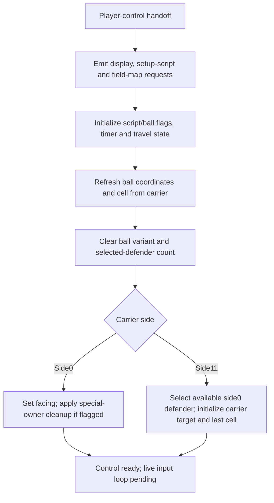

# Native player-control setup

The persistent session now advances the existing player-control handoff through the original setup into a control-ready state. It supports either possession side, updates ball position/cell from the carrier and selects the controlled defender when the opposing side owns the ball. It stops before the live input loop; movement and action selection are not yet playable.

## Supported setup



The setup follows original `$E0DF..$E145` with otherwise frozen presentation inputs:

- Set script flags and ball mode128, decision timer10, movement region255, travel accumulator0 and display parameter2.
- Preserve coordinate fractions. Copy carrier integer X/Y to the ball and recompute the field cell; earlier recovery phases deliberately kept their phase-local cell.
- Reset ball variant and selected-defender count, derive side from the owner, and set facing64 for side0 or0 for side11.
- For side0 with special-owner bit7 set, clear those flags and the low stamina byte of player20. Other stamina bytes remain unchanged.
- For side11, clear the opposing-player ID before selecting the nearest available side0 field player. Preserve the original strict radius/scan ordering and status exclusion. Set carrier target5 and remember its current cell for later AI decisions.
- Preserve remaining/extra time and ordinary experience totals. The original writes `$0469=1`, so the existing represented slot10 gets high byte1 while keeping its low byte; do not treat it as a new reward.

`find_nearest_field_player` is shared with loose-ball recovery. The existing pure recovery API retains its composition and selection rules.

## Presentation boundary

Ordered typed requests represent the clock/status display, setup script30, field map and side-specific status displays. These are requests for a future presentation layer, not a rendered reproduction. Waits, NMI, sound-driver behavior and controller/frame sampling are not executed in native setup. Display requests must not independently advance simulation randomness.

Phase1 still means entry to the player-control handler. New phase9 means setup completed before the original yield/input loop. Repeated setup, setup at a recovery/clock pause, keeper owners, outside-field carriers and missing contexts are rejected. The calculation commits copied state only after successful completion.

## Development usage

```sh
python3 tools/export_phase_session.py /private/control-entry-ram.bin /private/control-entry.cmjsession --phase 1
build/captain-phase-session /private/content-v6.cmjpack /private/control-entry.cmjsession \
  --setup-control --capture /private/control-ready.cmjsession
```

Interactive command: `setup-control`. It can follow `rewarded-contact`, `recover` and `continue-recovery` in one retained session when the initial snapshot captured the required contexts. The operation requires recovery, experience and control context rather than inventing values for old snapshots.

## Snapshot version4

`CMJSESSION4` is exactly304bytes: version3's layout with the version marker changed, followed by presence+seven control bytes:

| Field | Size | Original source |
| --- | ---: | --- |
| Presence | 1 | Explicit format flag |
| Decision timer | 1 | `$0614` |
| Facing | 1 | `$0517` |
| Controlled player | 1 | `$05FD` |
| Last carrier cell | 1 | `$0617` |
| Travel accumulator | 2 | `$0642/$0643`, little-endian |
| Display parameter | 1 | `$008E` |

Absent context requires zero padding. Versions1–3 remain readable with control context absent. `--without-control` explicitly omits it from export. Phase9 requires all three optional contexts, an interior ball and a field owner on the possession side; for side11, the controlled defender must be ID1–10. Unsupported versions/flags, missing phase context, truncation, trailing bytes and nonzero unused padding are rejected. Content version6 is unchanged. These development snapshots are not a complete game save or network protocol; all original data remains private.

## Evidence and limits

`tools/trace_ball_recovery_phase.py --prepare-control` observes original setup to `$E145`. It uses the existing disclosed cooperative scheduler and host frame/input/display/graphics acknowledgements, without skipping original calls or executing NMI/audio/PPU timing. Reports now record the ordered high-level presentation requests.

Seven private observations cover:

| Observation | Represented result |
| --- | --- |
| Recovered player2, side0 | Ball91,100; cell62; timer10 |
| Terminal player1 with count4 | Refresh ball to player1; clear count |
| Opposing player16; unavailable defenders | Ball161,131; cell174; select available defender2 after opponent reset |
| Special flags/stale control/slot10 bytes | Clear player20 low stamina; preserve unused side0 selection fields and slot10 low byte |
| Incoming side differs from carrier | Normalize side and preserve pre/post status-request ordering |
| Lower field edge | Ball48,80; cell0 |
| Upper field edge | Ball207,175; cell239 |

Normal native commands produce the same represented304-byte saved state as all seven original exports in manual hash inspection. Representative shared SHA-256 values:

| Observation | SHA-256 |
| --- | --- |
| Recovered player2 | `76ff3be7f038c75cec8487c5245becd7740d299bb66686c7db2670caae7d2e3c` |
| Opposing player16 | `102a33c5b580114e9ed665ceec4ef31c6cdad1a963f6fa1bbeb5f637e1a3f9c2` |
| Cleanup and preserved fields | `83c343ed788d8ef4456bd9a8db06807ce1239c5d7d7905a3d2e7c0afcd117200` |

Native presentation-request kinds/IDs agree with inspected original sequences, including the differing pre/post side example. Production builds and a fresh whole-plan static review are recorded in the work log. No automated tests were added or run. This evidence covers represented setup state, not live inputs, complete original graphics or full-match equivalence.

Joined interactive usage reaches the same base control-ready hash from rewarded contact→recovery→prepared control→setup. Repeated setup and setup with an old snapshot lacking control context are rejected without changing the session. Fresh independent static review found no material findings; it did not execute code or reproduce the observations.

Next: logical button/decision handling, carrier movement, AI/cell transitions and the clock/frame schedule, followed by the already explicit keeper/story/restart paths.
