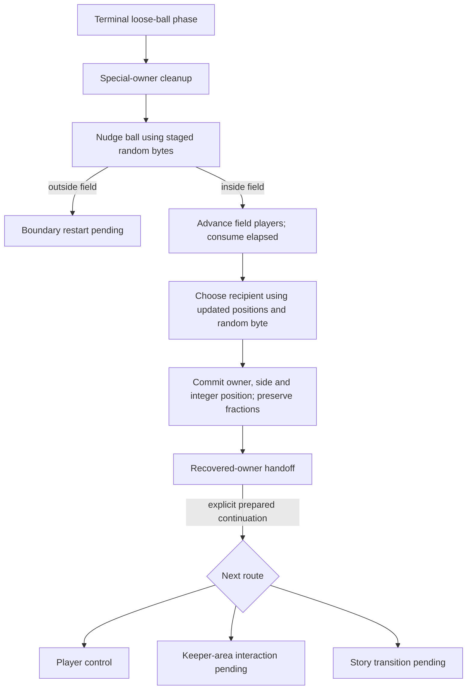

# Persistent loose-ball recovery

The native phase session now connects a supported terminal loose ball to a recovered field player, then exposes a prepared continuation into player control. The calculation uses persistent player positions/statuses, preserves coordinate fractions and carries clock/experience through the transition. It is still a development phase, not a playable match.

## Order of operations



The existing pure `recover_ball` API remains available. It now composes separate `jitter_loose_ball` and `recover_stationary_ball` helpers. This split matters because the original caller advances field players between jitter and recipient selection, and that update can shift the first random byte. The joined session selects the recipient from the resulting positions and random state without applying jitter twice.

Original entry `$8BDF` calls `$9070`, which conditionally clears a special owner flag and the low stamina byte of player20 when that player owns the ball. This call is **not** a random-generator call; an earlier research description has been corrected. No invented random step is added.

The joined operation requires selected-defender count0, as supplied by the supported terminal result2 path. The current persistent snapshot has no selected defender list; other direct-capture callers continue to use the pure helper with an explicit list.

## Ownership and pauses

The original ordinary handoff writes the new owner/side, copies only integer X/Y into the player's record, clears attack subtype, and initializes the ball variant only when it was zero. Native code preserves the fractional coordinate bytes. A possession-change sound request is an event; audio timing never advances this calculation.

`recover` stops at the represented boundary before original `$8C31` keeper-area/presentation handling. `continue-recovery` is an explicit prepared continuation with otherwise frozen inputs. It pauses for:

- The keeper-area gate: Y96–159 and X below80 or at least176.
- The special story gate: game mode4, side0, owner type other than1, owner integer X at least128.
- A prior outside-field diversion, which remains a separate boundary-restart phase and cannot use this continuation.

When neither subsequent gate applies, the prepared tail reaches player control. Original waits, rendering, controller sampling, sound-driver effects and NMI updates during presentation are not reproduced. A future live runtime must supply the appropriate post-presentation state.

## Development usage

```sh
python3 tools/export_phase_session.py /private/recovery-entry-ram.bin /private/recovery.cmjsession --phase 2
build/captain-phase-session /private/content-v6.cmjpack /private/recovery.cmjsession \
  --recover --capture /private/recovered.cmjsession
build/captain-phase-session /private/content-v6.cmjpack /private/recovered.cmjsession \
  --continue-recovery --capture /private/control.cmjsession
```

Interactive commands also accept `recover` and `continue-recovery`. They join the existing `rewarded-contact`, `contact`, `resume`, `advance`, `state` and exclusive `save` commands. A rejected command leaves the current session unchanged. Recovery/presentation pauses reject new contact or movement commands.

## Session version3

Content version6 is unchanged. `CMJSESSION3` is exactly296 bytes: the version2 layout, with its version marker changed, followed by a presence flag and six recovery context bytes:

| Context byte | Original represented field |
| --- | --- |
| Opposing player | `$0442` |
| Attack subtype | `$043C` |
| Special-owner flags | `$044C` |
| Ball variant | `$044E` |
| Game mode | `$0446` |
| X jitter control | `$062C` |

Absent context requires zero padding. Readers retain session versions1/2 with recovery context absent. `--without-recovery` explicitly omits it during export; it cannot be omitted for a recovery continuation phase. New phases are restart5, recovered owner6, keeper interaction7, story transition8. Those phases require zero selected defenders and captured context; phases6–8 additionally require an interior ball and a field owner on the possession side. Unsupported versions, invalid flags/relationships, truncation and trailing bytes are rejected.

This remains a development snapshot, not a complete game save or authenticated network protocol. ROMs, exported packs, RAM and snapshots remain private and ignored by Git.

## Evidence and limitations

`tools/trace_ball_recovery_phase.py` observes original entry `$8BDF` to the recovered-owner boundary, or an outside-field boundary. With `--continue-handoff`, it observes the prepared tail to player control or the keeper/story gate. Its cooperative scheduler/host frame/input/display/graphics acknowledgements are disclosed in the report. No original calls are skipped; NMI, PPU, audio and real frame timing are not emulated.

Eight private observations use the previously captured terminal result2 state and explicit constructed variants:

| Observation | Recovered owner / route |
| --- | --- |
| Captured terminal state, elapsed2 | Player2, side0; ordinary control tail |
| First random129, second2, elapsed2 | Ball107,92; player16 after movement; ordinary control tail |
| Stationary tie, first random0 | Player2, side0 |
| Stationary tie, first random128 | Player12, side11 |
| Special-owner flag and player20 | Flag/low stamina cleared; player2 collects |
| Jitter outside left field edge | Ball40,100; restart pause before movement |
| Keeper-area placement | Ownership handoff, then keeper interaction pause |
| Story-gate placement | Ownership handoff, then story transition pause |

Manual hash inspection of normal native saved output agrees with the original represented296-byte exports at all eight initial boundaries and seven subsequent boundaries. Representative shared hashes:

| State | SHA-256 |
| --- | --- |
| Captured-state recovered owner | `a9f0415283ac1bf18cf7bea302845aca36944632e156cfea1931beb77f51353d` |
| Captured-state player-control tail | `3caec3aafe038450da4c7afb9b891792df52d006051413893731bcb3fb189ddf` |
| Jitter/movement recovered owner | `822ea0eec0ad61e4088a44aaabd2f39c3e1937deba2285ddc8e84ddd0371989d` |

Normal interactive usage also joined rewarded terminal result2 → recovery → prepared player control in one retained session. It preserved clock452 and experience total2, transferred owner14/side11 to player2/side0, and produced the same represented boundary hashes. A repeated recovery command after player control was rejected without changing state.

These are bounded original observations and production usage, not an automated test suite or proof of full-game equivalence. Production Make/CMake builds and fresh static review are recorded in the work log; no automated tests were added or run. Full keeper interactions, restarts, story substitution, native player controls, ball-flight scheduling and live randomness remain future work.
