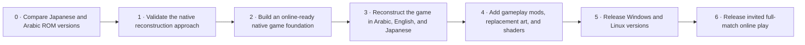

# Captain Majid PC Port — Working Roadmap

**Purpose:** English working reference for the project owner and ChatGPT. This is the canonical source for roadmap stages, dependencies, decisions, and status. A future Arabic fan page may present the same milestones in a more promotional style, but must not change their meaning or progress status.

**Last reviewed:** 2026-10-27
**Current project status:** ROM analysis and native feasibility work are in progress. A first native arithmetic kernel and local replica fixture are implemented; a playable match interaction remains to be built. See [ENGINE_PROGRESS.md](ENGINE_PROGRESS.md).
**Schedule:** No dates or delivery estimates are set. ROM analysis and a native feasibility milestone must inform estimates first.

## Project goal

Create a faithful native PC port of *Captain Tsubasa Vol. II: Super Striker* in Arabic, English, and Japanese, with gameplay mods, replacement pixel art, replacement music, and configurable shaders. Online play is a core requirement. The first online release should let a player invite a friend to play a full match. The architecture must also accommodate random matchmaking and sessions with more than two participants; exact player counts and shared-team control rules remain to be designed.

Initial desktop targets are Windows and Linux. A faithful reconstruction of the NES game's behavior is the reference; an emulator may be used during development to check behavior. The project should not be described as a completed decompilation or port until its corresponding work and checks are done.

## Roadmap at a glance

Stages 0 and 1 are **In progress**; later stages are **Planned**. The diagram shows order and dependencies, not an estimate or promise of dates. Online support, mod hooks, and graphics hooks must shape the foundation early; their complete player-facing features arrive after the core game is faithfully playable.

## Stages and exit checks

### 0. Compare the Japanese and Arabic ROM versions — In progress

**Goal:** Determine which code and content are shared, what each Arabic version changes, and which Arabic presentation should be the initial reference.

**Work:** Inventory the Japanese ROM and every supplied Arabic version; record file hashes and variant identifiers; compare program code, graphics, text data, and layout-related changes; choose the initial Arabic reference after reviewing the differences.

**Exit check:** An initial structural comparison is recorded in [ROM_ANALYSIS.md](ROM_ANALYSIS.md). Both Arabic variants change program code and graphics through distinct implementations. Text-engine mapping, emulator boot validation, and selection of the initial Arabic presentation reference remain.

### 1. Validate the native reconstruction approach — In progress

**Goal:** Establish a reliable way to study the original game and prove that its behavior can be reconstructed in native PC code.

**Work:** Use an established emulator as a behavior reference; map the ROM's hardware, code, data, and graphics; document a small representative gameplay flow; implement a throwaway native proof only after this study identifies a suitable slice.

**Exit check:** The project has a documented technical map, a repeatable comparison method, and evidence from a native proof that gameplay behavior can be matched. Record any feasibility issues before committing to a wider port scope.

**Evidence so far:** The first native action-strength kernel matches the isolated original routine across 6,656 comparison inputs. The expanded field-defender calculation matches original execution in 19,200 cases. Two native fixture processes agree on state and defender research calculations over a local TCP development adapter. A complete authentic shot and full-emulator gameplay comparison are still required; this stage is not complete.

**Additional evidence:** Standard skill-index adjustment, randomized action power, and pre-override goalkeeper comparison match original instruction execution for 69,632, 7,456, and 5,248 cases respectively. Stamina deduction, keeper story/state helpers, and one original random step match 25,756 further isolated cases. Immediate goalkeeper outcome writes match 384 cases, field-defender possession handoffs match 144, ordinary interior-field ball recovery matches 512, and nearby-defender selection matches 1,024. A gated action-0 continuation connects eligible field results to the existing keeper and goal/save calculations, and an orchestration helper dispatches ordered field-contact results to their immediate defender handoffs. The selector returns actual nearby player IDs, while contact attributes, thresholds, caller route values, and gameplay state remain explicit inputs. Content-table loading, caller-specific energy accounting, random scheduling, action-1 and other paths, and an ordered playable shot remain incomplete. See [SHOT_FLOW_TRACE.md](SHOT_FLOW_TRACE.md), [DEFENDER_SELECTION.md](DEFENDER_SELECTION.md), and [ENGINE_PROGRESS.md](ENGINE_PROGRESS.md).

**Content lookup progress:** Standard field-defender preparation now matches 16,064 executions of the original loader, including skill selection, move strength/effect, and stamina cost. The core accepts replaceable content; ordinary/generic/alternate field profile resolution now feeds preparation and matches 91,392 constructed ROM fixtures. Runtime content import and full match integration remain in progress. See [FIELD_PLAYER_PROFILES.md](FIELD_PLAYER_PROFILES.md). See [FIELD_DEFENDER_PREPARATION.md](FIELD_DEFENDER_PREPARATION.md).

### 2. Build an online-ready native foundation — Planned

**Goal:** Create the PC game structure so faithful reconstruction, Arabic content, modding, visual replacement, and online play can share one game simulation.

**Work:** Keep game rules separate from rendering and platform input; make simulation updates reproducible; provide clear boundaries for language/content, replacement graphics/music, and shader rendering; support Windows and Linux development from the start. Build and evaluate a small network interaction early. Keep participants separate from teams and footballers so invitations, random matchmaking, and future shared-team modes can use the same session structure. See [ENGINE_DIRECTION.md](ENGINE_DIRECTION.md).

**Exit check:** A native build can run a documented test scene or gameplay slice on Windows and Linux, and its game state can be advanced and compared reproducibly. The boundaries needed by later online and mod features are documented.

### 3. Reconstruct the full game in Arabic, English, and Japanese — Planned

**Goal:** Reproduce the original game's complete playable flow in Arabic, English, and Japanese, prioritizing the familiar Arabic wording and presentation.

**Work:** Rebuild the title and menus, match flow, game rules, campaign progression, sound, and other required game behavior from ROM study. Support the three agreed language versions, beginning with the chosen Arabic ROM's text and presentation. Compare other Arabic variants and represent their differences as separate content where possible.

**Exit check:** The selected reference version can be played from start to finish, with representative behavior checked against the reference game. Arabic, English, and Japanese text and screens are readable; Arabic matches the selected version's expected presentation.

### 4. Add gameplay mods, replacement art, and shaders — Planned

**Goal:** Let players customize the game beyond the original ROM while keeping the default experience faithful.

**Work:** Provide documented gameplay-mod and content-replacement interfaces; support higher-resolution or custom pixel-art assets; provide configurable shader effects inspired by the flexibility of RetroArch and ReShade.

**Exit check:** A sample gameplay mod, replacement graphic set, and shader preset can each be installed, enabled, and removed without modifying the game executable or original ROM files.

### 5. Prepare Windows and Linux releases — Planned

**Goal:** Package a dependable PC release of the faithful game and visual/gameplay enhancements.

**Work:** Package and document both desktop builds; exercise game launch, saves, controllers, all three language versions, mods, replacement graphics, and shaders on both platforms; provide clear setup and troubleshooting instructions.

**Exit check:** A new user can install and launch each build, play through the game, and use the supported language, mod, and graphics features using the published instructions.

### 6. Release invited full-match online play — Planned

**Goal:** Deliver the first online feature: a player can invite a friend and complete a full match together.

**Work:** Connect two players to the same match using the reproducible game simulation from Stage 2. Define the invite and connection flow, exchange only the match state needed for consistent play, and make disconnect or failed-connection behavior understandable.

**Exit check:** Two separate clients can start an invited match, complete it, and agree on the result. Online behavior is checked across supported Windows and Linux clients. Public matchmaking and sessions with additional participants are part of the longer-term scope; their control rules, player limits, and release checkpoints remain to be defined. Small online prototypes start during Stage 2, before this public-release milestone.

## Decisions recorded

- **Port direction:** Native reconstruction informed by the NES ROM and an emulator reference.
- **Language versions:** Arabic, English, and Japanese are planned; Arabic is the primary player experience. Compare the available Arabic variants before selecting the initial presentation baseline.
- **Initial platforms:** Windows and Linux.
- **Online priority:** Online play is a core project requirement. Begin synchronization experiments during the engine foundation. An invited full match is the first release target; random matchmaking and support for more than two participants must be accommodated in the architecture. Exact control rules and player limits remain open.
- **Engine direction:** Record the agreed foundation and next proof checkpoints in [ENGINE_DIRECTION.md](ENGINE_DIRECTION.md). Use the external disassembly as a verified research reference and write our implementation independently.
- **Mod and graphics goals:** Gameplay mods, replacement pixel art, and configurable shaders are required project goals.
- **Public presentation:** A future Arabic page will use Standard Arabic with nostalgic fan expressions and an NES game-menu visual direction. It will frame the project to build anticipation and mark stages as planned until evidence justifies a status change.
- **Public roadmap:** Rebuild the game in Arabic, English, and Japanese; add gameplay/graphics improvements; release Windows and Linux versions; then release invited full-match online play.
- **Visual references:** Online images from the Arabic game may be used on the future page when they improve it; source and attribution should be recorded.
- **No dates yet:** Estimates wait until the ROM comparison and feasibility work provide evidence.

## Status update rule

Keep every stage at **Planned** until its work has started. Change a stage to **In progress** only when there is a concrete artifact or implementation underway, and to **Complete** only when its exit check has evidence. When the Arabic page is built later, derive its milestone names and statuses from this reference; do not invent separate progress or delivery promises.

## Current analysis inputs

The verified Japanese ROM, one complete Arabic ROM, and the IPS patch for the Extraordinary Arabic variant are available to the current analysis workspace. Original uploads remain unchanged; reconstructed files stay outside the Git repository.
