# Captain Majid PC Port — Working Roadmap

**Purpose:** English working reference for the project owner and ChatGPT. This is the canonical source for roadmap stages, dependencies, decisions, and status. The Arabic fan page presents the same milestones briefly and with more excitement, without changing their meaning or progress status.

**Last reviewed:** 2026-10-28
**Current project status:** ROM analysis and native feasibility work are in progress. The native session now reaches an ordinary prepared shot from the field-action menu; defender choices, shot flight, and a complete playable match remain to be built. See [ENGINE_PROGRESS.md](ENGINE_PROGRESS.md) and [NATIVE_ACTION_MENU.md](NATIVE_ACTION_MENU.md).
**Schedule:** No dates or delivery estimates are set. ROM analysis and a native feasibility milestone must inform estimates first.

## Project goal

Create a faithful native PC port of *Captain Tsubasa Vol. II: Super Striker* in Arabic, English, and Japanese, with gameplay mods, replacement pixel art, replacement music, and configurable shaders. Online play is a core requirement. The first online release should let a player invite a friend to play a full match. The architecture must also accommodate random matchmaking and sessions with more than two participants; exact player counts and shared-team control rules remain to be designed.

## What kind of port this is

The intended product is a PC port: players should be able to play the same game on Windows and Linux. The current engineering method is an independent native reconstruction/reimplementation of the gameplay in C++, guided by bounded observations of the Japanese game. We are not recompiling original source code; that source is not available in the project. Disassembly and decompilation-style analysis help locate and understand behavior, but their output is a research map, not a ready-made PC engine. This path fits the project's goals for new translations, expandable text, replaceable graphics/audio, shaders, quality-of-life settings, and future online play.

Initial desktop targets are Windows and Linux. A faithful reconstruction of the NES game's behavior is the reference; an emulator may be used during development to check behavior. The project should not be described as a completed decompilation or port until its corresponding work and checks are done.

## Roadmap at a glance

Stages 0 and 1 are **In progress**; later stages are **Planned**. The diagram shows order and dependencies, not an estimate or promise of dates. Online support, text expansion, right-to-left Arabic, quality-of-life options, mod hooks, and graphics hooks must shape the foundation early; their complete player-facing features arrive as the core game becomes playable.

```mermaid
flowchart LR
    A["0 · Compare Japanese and Arabic ROM versions"] --> B["1 · Validate the native reconstruction approach"]
    B --> C["2 · Build an online-ready native game foundation"]
    C --> D["3 · Reconstruct the game in Arabic, English, and Japanese"]
    D --> E["4 · Add PC quality-of-life improvements"]
    E --> F["5 · Add gameplay mods, replacement art, and shaders"]
    F --> G["6 · Release Windows and Linux versions"]
    G --> H["7 · Release invited full-match online play"]
    H --> I["8 · Expand matchmaking and participants"]
```

## Stages and exit checks

### 0. Compare the Japanese and Arabic ROM versions — In progress

**Goal:** Determine which code and content are shared, what each Arabic version changes, and which Arabic presentation should be the initial reference.

**Work:** Inventory the Japanese ROM and every supplied Arabic version; record file hashes and variant identifiers; compare program code, graphics, text data, and layout-related changes; choose the initial Arabic reference after reviewing the differences.

**Exit check:** An initial structural comparison is recorded in [ROM_ANALYSIS.md](ROM_ANALYSIS.md). Both Arabic variants change program code and graphics through distinct implementations. Text-engine mapping, emulator boot validation, and selection of the initial Arabic presentation reference remain.

### 1. Validate the native reconstruction approach — In progress

**Goal:** Establish a reliable way to study the original game and prove that its behavior can be reconstructed in native PC code.

**Work:** Use an established emulator as a behavior reference; map the ROM's hardware, code, data, and graphics; document a small representative gameplay flow; implement a throwaway native proof only after this study identifies a suitable slice.

**Exit check:** The project has a documented technical map, a repeatable comparison method, and evidence from a native proof that gameplay behavior can be matched. Record any feasibility issues before committing to a wider port scope.

**Evidence so far:** The first native action-strength kernel matches the isolated original routine across 6,656 comparison inputs. The expanded field-defender calculation matches original execution in 19,200 cases. Two native fixture processes agree on state and defender research calculations over a local TCP development adapter. A complete authentic shot and full-emulator gameplay comparison are still required; this stage is not complete.

**Additional evidence:** Standard skill-index adjustment, randomized action power, and pre-override goalkeeper comparison match original instruction execution for 69,632, 7,456, and 5,248 cases respectively. Stamina deduction, keeper story/state helpers, and one original random step match 25,756 further isolated cases. Immediate goalkeeper outcome writes match 384 cases, field-defender possession handoffs match 144, ordinary interior-field ball recovery matches 512, and nearby-defender selection matches 1,024. A gated action-0 continuation connects eligible field results to the existing keeper and goal/save calculations, and an orchestration helper dispatches ordered field-contact results to their immediate defender handoffs. The selector returns actual nearby player IDs, while contact attributes, thresholds, caller route values, and gameplay state remain explicit inputs. Content-table loading, caller-specific energy accounting, random scheduling, action-1 and other paths, and an ordered playable shot remain incomplete. See [SHOT_FLOW_TRACE.md](SHOT_FLOW_TRACE.md), [DEFENDER_SELECTION.md](DEFENDER_SELECTION.md), and [ENGINE_PROGRESS.md](ENGINE_PROGRESS.md).

**Content lookup progress:** Standard field-defender preparation now matches 16,064 executions of the original loader, including skill selection, move strength/effect, and stamina cost. The core accepts replaceable content; ordinary/generic/alternate field profile resolution now feeds preparation and matches 91,392 constructed ROM fixtures. Runtime content import and full match integration remain in progress. See [FIELD_PLAYER_PROFILES.md](FIELD_PLAYER_PROFILES.md). See [FIELD_DEFENDER_PREPARATION.md](FIELD_DEFENDER_PREPARATION.md).

### 2. Build an online-ready native foundation — Planned

**Goal:** Create the PC game structure so faithful reconstruction, Arabic content, modding, visual replacement, and online play can share one game simulation.

**Work:** Keep game rules separate from rendering and platform input; make simulation updates reproducible; provide clear boundaries for language/content, replacement graphics/music, and shader rendering; support Windows and Linux development from the start. Build and evaluate a small network interaction early. Keep participants separate from teams and footballers so invitations, random matchmaking, and future shared-team modes can use the same session structure. See [ENGINE_DIRECTION.md](ENGINE_DIRECTION.md).

**Exit check:** A native build can run a documented test scene or gameplay slice on Windows and Linux, and its game state can be advanced and compared reproducibly. The boundaries needed by later online and mod features are documented.

### 3. Reconstruct the full game in Arabic, English, and Japanese — Planned

**Goal:** Reproduce the original game's complete playable flow in Arabic, English, and Japanese, prioritizing the familiar Arabic wording and presentation.

**Work:** Rebuild the title and menus, match flow, game rules, campaign progression, sound, and other required game behavior from ROM study. Create fresh Arabic, English, and Japanese text content that can grow beyond the original ROM's text limits. Keep wording and layout data separate from simulation rules. Arabic presentation must support right-to-left reading, joined Arabic letter shaping, mixed Arabic/Latin/numeric text, and right-aligned menus. Compare the Arabic ROM variants and use their wording and presentation as references rather than fixed text limits.

**Exit check:** The selected reference version can be played from start to finish, with representative behavior checked against the reference game. Arabic, English, and Japanese text and screens are readable. The new Arabic translation follows right-to-left layout and keeps the familiar characters and tone without being restricted to the old text length.

### 4. Add PC quality-of-life improvements — Planned

**Goal:** Make the familiar game easier to play on a computer while preserving its original football rules and recognizable pace.

**Work:** Choose quality-of-life options after a stable playable match loop exists. Prepare settings, input, save, and presentation boundaries during the port so useful changes can be added without rewriting gameplay. The exact options remain open until the core match is usable and the owner has prioritized them.

**Exit check:** The agreed PC conveniences work in a complete match, can be turned on or off where appropriate, and do not change the default rules or online agreement unexpectedly.

These improvements are planned after the core play loop is stable, before release packaging. Some enabling work happens earlier; the project does not need to wait until every port feature is finished before deciding how options fit.

### 5. Add gameplay mods, replacement art, and shaders — Planned

**Goal:** Let players customize the game beyond the original ROM while keeping the default experience faithful.

**Work:** Provide documented gameplay-mod and content-replacement interfaces; support higher-resolution or custom pixel-art assets; provide configurable shader effects inspired by the flexibility of RetroArch and ReShade.

**Exit check:** A sample gameplay mod, replacement graphic set, and shader preset can each be installed, enabled, and removed without modifying the game executable or original ROM files.

### 6. Prepare Windows and Linux releases — Planned

**Goal:** Package a dependable PC release of the faithful game and visual/gameplay enhancements.

**Work:** Package and document both desktop builds; exercise game launch, saves, controllers, all three language versions, mods, replacement graphics, and shaders on both platforms; provide clear setup and troubleshooting instructions.

**Exit check:** A new user can install and launch each build, play through the game, and use the supported language, mod, and graphics features using the published instructions.

### 7. Release invited full-match online play — Planned

**Goal:** Deliver the first online feature: a player can invite a friend and complete a full match together.

**Work:** Connect two players to the same match using the reproducible game simulation from Stage 2. Define the invite and connection flow, exchange only the match state needed for consistent play, and make disconnect or failed-connection behavior understandable.

**Exit check:** Two separate clients can start an invited match, complete it, and agree on the result. Online behavior is checked across supported Windows and Linux clients. Public matchmaking and sessions with additional participants are part of the longer-term scope; their control rules, player limits, and release checkpoints remain to be defined. Small online prototypes start during Stage 2, before this public-release milestone.

### 8. Expand matchmaking and participants — Planned

**Goal:** Let players find opponents without an invitation and make room for matches with more participants.

**Work:** Add random matchmaking and define participant counts, shared-team controls, connection recovery, and rules compatibility once the two-player invited match is stable. The game design, player limit, and control arrangements are open decisions.

**Exit check:** Players can enter compatible random matches and complete a match with the supported participant arrangement on the released Windows and Linux builds.

## Decisions recorded

- **Port direction:** Native reconstruction informed by the NES ROM and an emulator reference.
- **Language and text expansion:** Create fresh Arabic, English, and Japanese text content that can be extended independently of original ROM limits. Arabic is the primary player experience and must render right-to-left, including letter shaping and mixed-direction text.
- **Initial platforms:** Windows and Linux.
- **Online priority:** Online play is a core project requirement. Begin synchronization experiments during the engine foundation. An invited full match is the first release target; random matchmaking and support for more than two participants must be accommodated in the architecture. Exact control rules and player limits remain open.
- **Engine direction:** Record the agreed foundation and next proof checkpoints in [ENGINE_DIRECTION.md](ENGINE_DIRECTION.md). Use the external disassembly as a verified research reference and write our implementation independently.
- **Mod and graphics goals:** Gameplay mods, replacement pixel art, and configurable shaders are required project goals.
- **Public presentation:** The Arabic page uses Standard Arabic with nostalgic fan expressions and an NES game-menu visual direction. It includes brief dated progress notes tied to a concrete milestone, with no guessed completion percentage or delivery date.
- **Quality of life:** Plan computer-friendly options after a stable match loop, with settings/input/save boundaries considered during the port. The exact feature list awaits the owner's priorities.
- **Public roadmap:** Rebuild and freshly translate the game in Arabic, English, and Japanese; add quality-of-life and mod/graphics improvements; release Windows and Linux versions; then release invited full-match online play and expand to random matchmaking/additional participants.
- **Visual references:** Online images from the Arabic game may be used on the future page when they improve it; source and attribution should be recorded.
- **No dates yet:** Estimates wait until the ROM comparison and feasibility work provide evidence.

## Status update rule

Keep every stage at **Planned** until its work has started. Change a stage to **In progress** only when there is a concrete artifact or implementation underway, and to **Complete** only when its exit check has evidence. The Arabic page uses a short dated update with its milestone; refresh it on each work day with a concrete result, never an invented percentage or delivery date.

## Current analysis inputs

The verified Japanese ROM, one complete Arabic ROM, and the IPS patch for the Extraordinary Arabic variant are available to the current analysis workspace. Original uploads remain unchanged; reconstructed files stay outside the Git repository.
